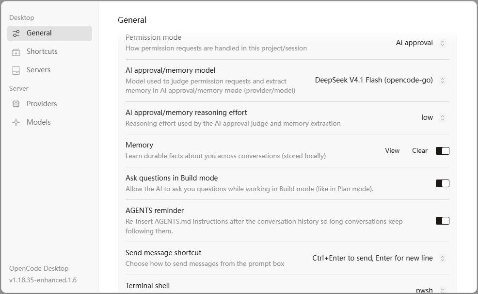

# OpenCode Enhanced

  <a href="README.md">English</a> |
  <a href="README.zh.md">简体中文</a>

Built on the OpenCode v1.18.35 core, with a set of practical feature upgrades.

This is the harness I use every day. Every feature in it was refined over and over against my own daily workflows, and it has gone through long-term internal use and iteration up to version 1.6. I am now open-sourcing this project — I hope you enjoy using it. Give it a ⭐ so you can find it again anytime.

## How to Use

Only the Windows version is released so far, now upgraded to version 1.7. To download, see the [Releases page](https://github.com/falconwho/opencode-enhanced/releases).

- System files and configuration are fully isolated, so your existing OpenCode installation is not affected.
- Portable edition: unzip the archive and open `opencode Enhanced.exe` inside to start using it.
- The interface supports multiple languages.

## The Classic UI Is Back!

Not used to OpenCode's new interface? This project brings the classic UI back! Perfect for those who prefer the old look.

---

---

## What's Added Compared to the Original OpenCode

### Core Improvements:

| ---New Features--- |  |
|------|------|
| 🎯 **AI Approval** | New AI auto-approval for permission requests! |
| 🪇 **Fork Conversations** | You can now branch off a new session from a specific message in a multi-turn conversation history. |
| 🔗 **Reference Other Conversations in Chat** | Type @ in the prompt box, then type a conversation title to quickly filter and reference it — or right-click a conversation, copy its link, and paste the ID into the prompt box. |
| 📇 **Memory Module** | Envious of Codex's memory system? Now you can use one in OpenCode too! The context structure is optimized for the memory system, improving cache hit rates and speeding up cache cold prefill for locally deployed AI models. |
| 🗨️ **Ask Questions in Build Mode** | When enabled, the model can also ask you questions in Build mode, reducing the chance that plans go off track under vague instructions. |
| 🛡️ **Stronger Instruction Adherence** | Strengthens the model's attention to global instructions in long contexts. Optionally re-inserts the AGENTS.md content near the tail of long contexts, improving global-instruction adherence for models that follow AGENTS.md poorly. |

> The AI approval and memory model and their reasoning effort can be changed in Settings. Both the official OpenCode plan and third-party model providers are supported directly, with no extra API configuration. On first launch, the default is DeepSeek V4.1 Flash from the OpenCode Go plan, with reasoning effort set to low.

---

### Interaction Updates:

| ---New Features--- |  |
|------|------|
| 📂 **Grouping** | You can now create virtual groups in a project's session list to organize conversations! Right-click a conversation to choose the target folder to move it into. |
| 🏃‍♀️‍➡️ **Quick Message Navigation** | A navigation bar on the left of the conversation gives you a quick preview of every message round in a long chat; click to jump to the corresponding message. |
| 🧑‍🎓 **Toggle Reasoning Display** | Use the icon in the top-right corner of the chat to quickly toggle the reasoning summary, with a preview built in. |
| 📄 **Markdown Display Fixes** | Markdown now renders correctly in conversations — headings at every level display at the right sizes. |
| 🟰 **Tool Spacing** | Tightened the rendering margins around Shell and other tools so they no longer get in the way of reading. |
| 🟥 **Red Stop Button** | A more prominent red stop button — now you can tell from across the room, even from bed, whether your computer has finished the job! |
| 🔤 **Light-Blue User Messages** | Sent user messages now use a light blue background. |
| ↩️ **Enter for Newline** | Pick your preferred send shortcut: optionally send with Ctrl+Enter and use Enter for a newline. |

## Other

> This is a personal project — it is not developed by, nor affiliated with, the OpenCode team.
