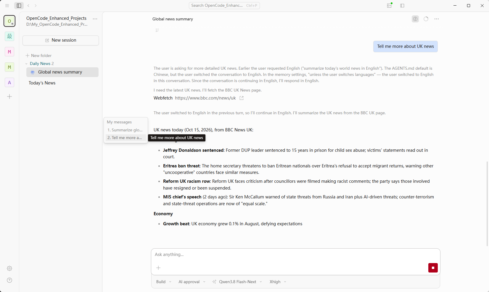
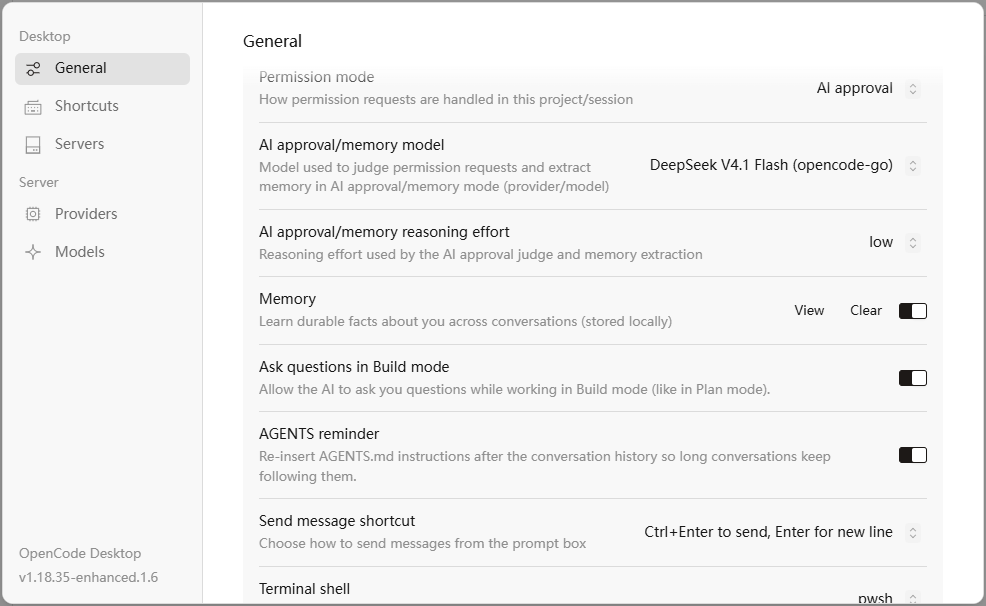

# OpenCode Enhanced

  <a href="README.md">English</a> |
  <a href="README.zh.md">简体中文</a>

Built on the OpenCode v1.18.35 core, with a set of practical feature upgrades.

This is the harness I use every day. Every feature in it was refined over and over against my own daily workflows, and it has gone through long-term internal use and iteration up to version 1.15.4. I am now open-sourcing this project — I hope you enjoy using it. Give it a ⭐ so you can find it again anytime.

## How to Use

Only the Windows version is released so far, now upgraded to version 1.15.4. To download, see the [Releases page](https://github.com/falconwho/opencode-enhanced/releases). For the full change history, see [RELEASE-NOTES.md](RELEASE-NOTES.md).

- System files and configuration are fully isolated, so your existing OpenCode installation is not affected.
- Portable edition: unzip the archive and open `opencode Enhanced.exe` inside to start using it.
- The interface supports multiple languages.

### What's New in 1.15.4

This build rolls up the complete 1.10 through 1.15.4 feature line:

- **Memory v3**: local SQLite memory with user, project, and shared scopes; memory palace rooms and slots; hybrid FTS5 plus local-embedding retrieval with keyword fallback; nine model-facing memory tools.
- **Memory maintenance**: reflection suggestions, independent distillation, multi-query search rewriting, pending ingest replay, rooms, audit records, JSON backup/restore, Markdown export, and embedding rebuild.
- **Memory context after compaction**: after context compaction, a fresh full memory packet is rebuilt at the head of the model context; later memory changes update that packet in place, and old scattered deltas are filtered out.
- **Stable prompt cache**: Halogen side requests use `no_store`; root sessions keep stable `X-Halogen-Keep` / `X-Halogen-From`; date and Plan/Build reminders are persisted without rewriting existing history.
- **Session state isolation**: new sessions start from build, existing sessions restore their own agent/model/thinking level, and forked sessions inherit the source message state.
- **AGENTS attention reinforcement**: AGENTS.md reminders are inserted at adaptive intervals and kept out of the visible chat stream.
- **Conversation workflow**: continuous `@` mentions for multiple files, sessions, and agents; Enter-to-rename for session folders; automatic bottom positioning for normal session entry and the message navigator.
- **UI polish**: compact always-visible 3px scrollbars, message dates, unified tool-row spacing, top-right toast placement, reasoning preview follow, and a two-line version badge in Settings.
- **Stability fixes**: duplicate titlebar actions, memory dialog crashes and HTTP 400 errors, compaction rendering, and the to-do list lifecycle.

## The Classic UI Is Back!

Not used to OpenCode's new interface? This project brings the classic UI back! Perfect for those who prefer the old look.

---

---

## What's Added Compared to the Original OpenCode

### Core Improvements:

| ---New Features--- |  |
|------|------|
| 🎯 **AI Approval** | New AI auto-approval for permission requests! |
| 🪇 **Fork Conversations** | You can now branch off a new session from a specific message in a multi-turn conversation history. |
| 🔗 **Reference Other Conversations in Chat** | Type @ in the prompt box, then type a conversation title to quickly filter and reference it — or right-click a conversation, copy its link, and paste the ID into the prompt box. |
| 🧠 **Memory v3** | Local SQLite long-term memory with user, project, and shared scopes, memory palace rooms, hybrid retrieval, reflection, distillation, and nine model-facing memory tools. |
| 🗂️ **Memory Workspace** | A dedicated memory window for overview, library, profile, records, operations, backup/restore, Markdown export, and embedding rebuild. |
| 🧩 **Session State Isolation** | Each conversation keeps its own agent, model, and thinking level; new sessions default to build, and forks inherit the source message state. |
| 🗨️ **Ask Questions in Build Mode** | When enabled, the model can also ask you questions in Build mode, reducing the chance that plans go off track under vague instructions. |
| 🛡️ **Prompt Cache Stability** | Halogen side requests are isolated from the main prompt cache, and date / Plan-Build reminders no longer rewrite existing history. |
| 🛡️ **AGENTS Attention Reinforcement** | Inserts AGENTS.md reminders at adaptive intervals based on the model's usable context, avoiding insertions near the compaction threshold while improving cache hit rates. |
| 📜 **To-do List Fix** | Fixed the upstream bug where a new conversation still showed the previous conversation's to-do list; the current conversation's to-do list and progress are rebuilt. |

> The AI approval and memory models and their reasoning effort can be changed in Settings. Both the official OpenCode plan and third-party model providers are supported directly, with no extra API configuration. On first launch, the default is DeepSeek V4.1 Flash from the OpenCode Go plan, with reasoning effort set to low.

---

### Interaction Updates:

| ---New Features--- |  |
|------|------|
| 📂 **Grouping** | You can now create virtual groups in a project's session list to organize conversations! Right-click a conversation to choose the target folder, and press Enter to rename folders immediately. |
| 🏃‍♀️‍➡️ **Quick Message Navigation** | A navigation bar on the left of the conversation gives you a quick preview of every message round in a long chat; click to jump to the corresponding message, and it follows the bottom when you switch sessions. |
| 🧑‍🎓 **Toggle Reasoning Display** | Use the icon in the top-right corner of the chat to quickly toggle the reasoning summary, with a preview built in. |
| 📄 **Markdown Display Fixes** | Markdown now renders correctly in conversations — headings at every level display at the right sizes. |
| 🟰 **Compact Tool Rows** | Tool and file-operation rows use a tighter 24px rhythm, so they no longer interrupt reading. |
| 🟥 **Red Stop Button** | A more prominent red stop button — now you can tell from across the room, even from bed, whether your computer has finished the job! |
| 🔤 **Light-Blue User Messages** | Sent user messages now use a light blue background. |
| ↩️ **Enter for Newline** | Pick your preferred send shortcut: optionally send with Ctrl+Enter and use Enter for a newline. |
| 🗓️ **Message Dates** | User messages show a local date next to the existing time. |
| 🖱️ **Unified Scrollbars** | The sidebar, message navigator, reasoning preview, and main conversation share the same compact always-visible scrollbar. |
| 📎 **Continuous @ Mentions** | You can now @ multiple files, sessions, or agents in one prompt, including after Chinese text or line breaks. |
| 🖼️ **Faster Image Input** | Typing after inserting images no longer rebuilds and re-decodes the image previews on every keystroke. |
| 🔔 **Top-Right Toasts** | Permission, question, success, and error notifications now appear at the top-right of the conversation instead of covering the input box. |
| 🏷️ **Version Badge** | The Settings footer shows the OpenCode version and the Enhanced release version on two lines. |

## Other

> This is a personal project — it is not developed by, nor affiliated with, the OpenCode team.
