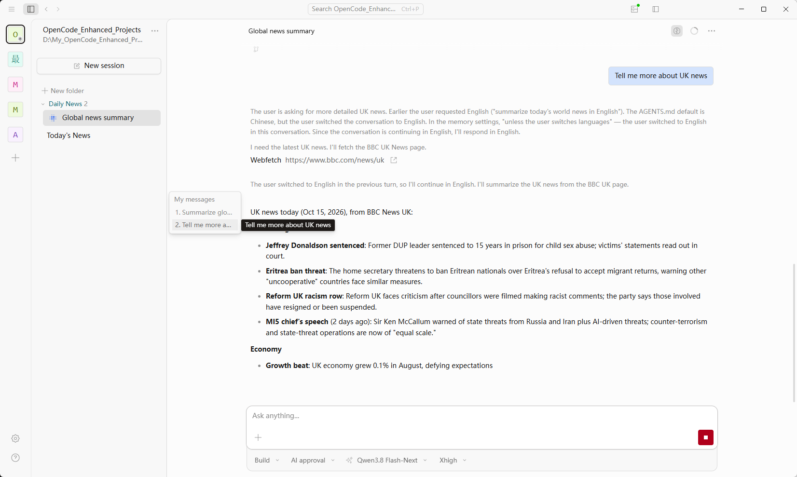
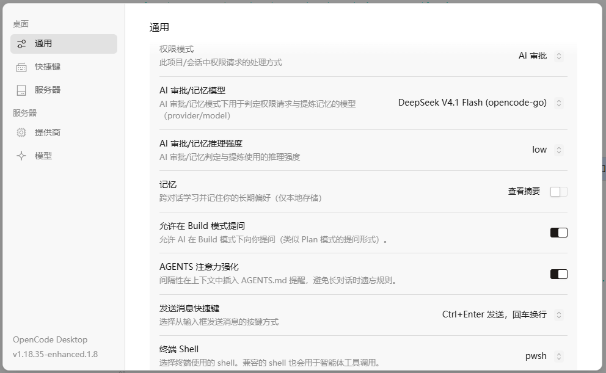

# OpenCode 增强版

  <a href="README.md">English</a> |
  <a href="README.zh.md">简体中文</a>

基于 OpenCode v1.18.35 版本内核改进而来，带来了多个实用的功能升级。

这是我每天都在用的 Harness，里面每个功能都是我根据日常使用场景反复打磨而来的，已经过长期内部使用和迭代到 1.15.4 版。现在把这个项目开源给大家，希望大家用得开心。⭐ 一下，下次随时能找到。

## 使用方式

目前发布了 Windows 版本，现在已经升级到 1.15.4 版，下载点击 [发布页面](https://github.com/falconwho/opencode-enhanced/releases)。完整更新记录见 [RELEASE-NOTES.md](RELEASE-NOTES.md)。

- 系统文件和配置参数独立，不影响现有 OpenCode 运行。
- 免安装版，解压 zip 后直接打开里面的 `opencode Enhanced.exe` 即可使用。
- 界面支持多语言。

### 1.15.4 版更新内容

本版本整合了 1.10 到 1.15.4 的完整功能线：

- **Memory v3**：本地 SQLite 长期记忆，支持 user、project、shared 三种作用域；记忆宫殿房间与桩位；FTS5 与本地向量混合检索，向量不可用时自动降级关键词检索；9 个面向模型的记忆工具。
- **记忆维护**：反思建议、独立蒸馏、多查询改写、pending ingest 重放、房间、审计记录、JSON 备份恢复、Markdown 导出和 embedding 重建。
- **压缩后的记忆上下文**：上下文压缩后，在模型上下文头部重建一份完整记忆包；后续记忆变化原位更新这份头部包，旧的散落 delta 不再进入上下文。
- **稳定 prompt 缓存**：Halogen 辅助请求使用 `no_store`；根会话保持稳定的 `X-Halogen-Keep` / `X-Halogen-From`；日期和 Plan/Build 提醒持久化，但不再改写已有历史。
- **会话状态隔离**：新会话默认 build，已有会话恢复自己的 agent/model/思考强度，fork 会话继承被 fork 消息的状态。
- **AGENTS 注意力强化**：按自适应间隔插入 AGENTS.md 提醒，并且不进入可见聊天流。
- **对话工作流**：同一个输入框可连续 @ 多个文件、会话和智能体；分组文件夹回车即可重命名；普通进入会话和“我的消息”导航自动停在底部。
- **界面优化**：始终可见的 3px 紧凑滚动条、消息日期、统一的工具行间距、右上角 toast、推理预览跟随，以及设置页两行版本标识。
- **稳定性修复**：重复标题栏按钮、记忆窗口崩溃和 HTTP 400、压缩后渲染、to-do 列表生命周期等问题。

## 经典 UI 界面回来了！

OpenCode 的新界面用不习惯？这个项目带回来了经典 UI 界面！适合喜欢旧版界面的朋友们。

---

---

## 相比原版 OpenCode 增加了什么

### 内核优化：

| ---新增功能--- |  |
|------|------|
| 🎯 **AI 审批** | 新增 AI 自动审批权限功能！ |
| 🪇 **Fork 对话** | 你现在可以从一个多轮对话历史中的某条回复消息中继续开始新的会话。 |
| 🔗 **聊天中引用其他对话** | 在对话框中输入 @ 后，输入对话标题快速筛选引用对话，或者在对话上右键选择复制链接并粘贴 ID 到对话框。 |
| 🧠 **Memory v3** | 本地 SQLite 长期记忆，支持 user、project、shared 三种作用域；记忆宫殿房间；混合检索；反思、蒸馏，以及 9 个面向模型的记忆工具。 |
| 🗂️ **记忆工作区** | 独立的记忆窗口，包含概览、记忆库、画像、记录、运维、备份恢复、Markdown 导出和 embedding 重建。 |
| 🧩 **会话状态隔离** | 每个会话保留自己的 agent、模型和思考强度；新会话默认 build，fork 会话继承被 fork 消息的状态。 |
| 🗨️ **Build 中提问** | 可以选择开启后，模型在 Build 模式下也可向你提问，减少模糊指令下模型规划跑偏的问题。 |
| 🛡️ **Prompt 缓存稳定** | Halogen 辅助请求与主对话 prompt 缓存隔离；日期和 Plan/Build 提醒不再改写已有历史。 |
| 🛡️ **AGENTS 注意力强化** | 按模型可用上下文自适应间隔插入 AGENTS.md 提醒，避开接近压缩阈值的位置，同时提高缓存命中率。 |
| 📜 **To-do 任务列表修复** | 修复了官方 to-do 任务列表在新的对话中依然显示旧任务列表的 bug，重建当前对话的 to-do 列表内容和进度。 |

> 可以在设置中更改 AI 审批与记忆模型以及对应推理强度，支持直接调用 OpenCode 官方套餐以及第三方接入模型，不需要额外 API 配置。首次启动默认为 OpenCode Go 套餐的 DeepSeek V4.1 Flash 模型，推理强度 low。

---

### 交互更新：

| ---新增功能--- |  |
|------|------|
| 📂 **分组功能** | 你现在可以在项目的会话列表中建立虚拟分组文件夹进行归类了！在对话上右键可选择目标分组文件夹，按回车即可立即重命名文件夹。 |
| 🏃‍♀️‍➡️ **对话快捷跳转** | 对话左侧加入导航栏，快速预览长对话中的每轮消息，点击可跳转到对应消息；切换会话时自动停在底部。 |
| 🧑‍🎓 **切换推理内容显示** | 现在你可以使用对话界面右上角的图标快速切换推理摘要的显示，且有预览功能。 |
| 📄 **Markdown 显示修正** | 对话中可以正确显示 Markdown 格式，各级标题都能正确渲染大小了。 |
| 🟰 **紧凑工具行** | 工具和文件操作行使用更紧凑的 24px 节奏，不再打断阅读。 |
| 🟥 **红色停止键** | 更显眼的红色停止键，这下你可以躺在床上也能看到远处的电脑有没有把活干完了！ |
| 🔤 **淡蓝色用户消息** | 用户发送的历史消息框现在改为淡蓝色底色。 |
| ↩️ **回车换行** | 根据你的喜好来选择消息发送快捷键。可选 Ctrl+Enter 发送消息，回车换行。 |
| 🗓️ **消息日期** | 用户消息在原有时间旁显示本地日期。 |
| 🖱️ **统一滚动条** | 左侧会话栏、“我的消息”、推理预览和主对话共用同一种紧凑、始终可见的滚动条。 |
| 📎 **连续 @ 多个内容** | 同一个输入框可以连续 @ 多个文件、会话或智能体，中文和换行之后也可以继续 @。 |
| 🖼️ **图片输入更流畅** | 插入图片后继续输入文字，不再每次按键都重建并重新解码图片预览。 |
| 🔔 **右上角通知** | 权限、问答、成功和错误提示改为出现在主对话区右上角，不再遮挡输入框。 |
| 🏷️ **版本标识** | 设置页底部两行显示 OpenCode 版本和增强版版本。 |

## 其他

> 该项目为个人项目，不是 OpenCode 团队官方开发，且不存在隶属关系。
