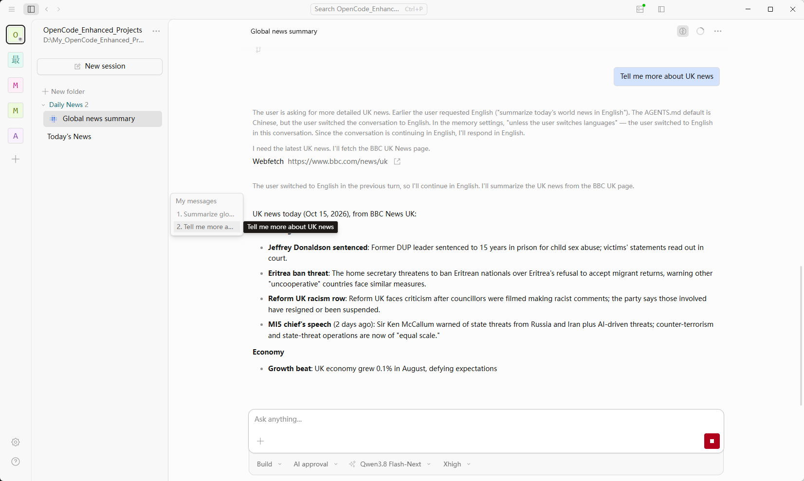
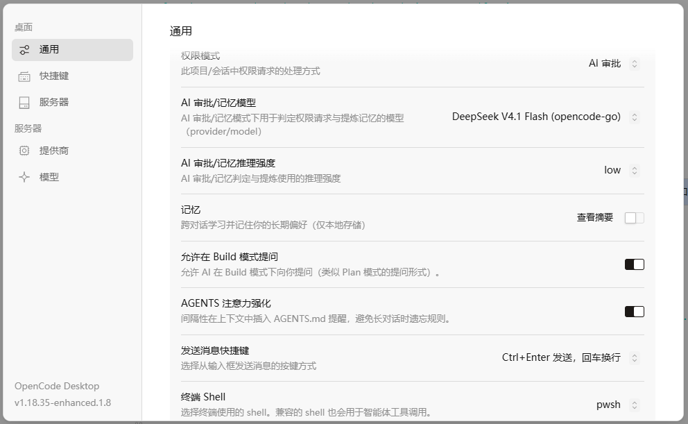

# OpenCode 增强版

  <a href="README.md">English</a> |
  <a href="README.zh.md">简体中文</a> 

基于OpenCode v1.18.35 版本内核改进而来。带来了多个实用的功能升级。

这是我每天都在用的Harness，里面每个功能都是我根据日常使用场景反复打磨而来的，已经过长期内部使用和迭代到1.6版。现在把这个项目开源给大家，希望大家用得开心。⭐一下，下次随时能找到。

## 使用方式

目前发布了window版本，现在已经升级1.8版，下载点击 [发布页面](https://github.com/falconwho/opencode-enhanced/releases)

- 系统文件和配置参数独立，不影响现有OpenCode运行。
- 免安装版，解压zip后直接打开里面的 opencode Enhanced.exe 即可使用
- 界面支持多语言

### 1.8版更新内容

- 修复旧任务 todo 列表在新任务中重新出现的问题：新任务会清空上一轮 todo，只显示本轮实际提交的列表；明确说“继续”时保留上一轮进度不变。

### 1.7版更新内容

- 重写记忆系统，使用类似codex的上下文注入记忆摘要文件，按需查询记忆细节的方式，减少了记忆内容在上下文中的信息，并提高缓存命中率。
- AGENTS.md注意力强化功能调整，改为使用上下文分段式持久化逻辑，提高缓存命中率。
- 此版本的数据结构调整较大，建议先备份"OpenCode Enhanced"数据库再使用。

## 经典UI界面回来了！

OpenCode的新界面用不习惯？这个项目带回来了经典UI界面！适合喜欢旧版界面的朋友们。

---

---

## 相比原版OpenCode增加了什么

### 内核优化：

| ---新增功能--- |  |
|------|------|
| 🎯 **AI审批** | 新增AI自动审批权限功能！ |
| 🪇 **Fork对话** | 你现在可以从一个多轮对话历史中的某条回复消息中继续开始新的会话。 |
| 🔗 **聊天中引用其他对话** | 在对话框中输入@后，输入对话标题快速筛选引用对话，或者在对话上右键选择复制链接并粘贴ID到对话框。 |
| 📇 **记忆模块** | 眼馋Codex的记忆系统？你现在也可以在OpenCode上使用了！上下文结构针对记忆系统做了优化设计，提高了缓存命中率，加快了本地部署的AI的缓存cold prefill效率。 |
| 🗨️ **Build 中提问** | 可以选择开启后，模型在Build模式下也可向你提问，减少模糊指令下模型规划跑偏的问题。 |
| 🛡️ **AGENTS 注意力强化** | 按模型可用上下文自适应间隔插入 AGENTS.md 提醒，避开接近压缩阈值的位置，同时提高缓存命中率。 |

> 可以在设置中更改AI审批与记忆模型以及对应推理强度，支持直接调用Opencode官方套餐以及第三方接入模型，不需要额外API配置。首次启动默认为OpenCode Go套餐的DeepSeek V4.1 Flash模型，推理强度low。

---

### 交互更新：

| ---新增功能--- |  |
|------|------|
| 📂 **分组功能** | 你现在可以在项目的会话列表中建立虚拟分组文件夹进行归类了！在对话上右键可选择想要移动的目标分组文件夹。 |
| 🏃‍♀️‍➡️ **对话快捷跳转** | 对话左侧加入导航栏，快速预览长对话中的每轮消息，点击可跳转到对应消息。 |
| 🧑‍🎓 **切换推理内容显示** | 现在你可以使用对话界面右上角的图标快速切换推理摘要的显示，且有预览功能。 |
| 📄 **Markdown显示修正** | 对话中可以正确显示Markdown格式，各级标题都能正确渲染大小了。 |
| 🟰 **工具显示间距** | 缩小了Shell等工具的渲染边界间距，避免影响阅读。 |
| 🟥 **红色停止键** | 更显眼的红色停止键，这下你可以躺在床上也能看到远处的电脑又没有把活干完了！ |
| 🔤 **淡蓝色用户消息** | 用户发送的历史消息框现在改为淡蓝色底色。 |
| ↩️ **回车换行** | 根据你的喜好来选择消息发送快捷键。可选Ctrl+Enter发送消息，回车换行。 |

## 其他
> 该项目为个人项目，不是 OpenCode 团队官方开发，且不存在隶属关系。